# Use Case: Assembler Explanation & Understanding

> **Prerequisites:** None — setup is included in this use case
> **Code Set:** `AsmSampleCode` — 3 Assembler programs, 2 macros, 1 COBOL program
> **Duration:** 30–45 minutes
> **Difficulty:** Beginner–Intermediate

---

## Overview

In this use case, you will use Bob to understand a real IBM High Level Assembler (HLASM) application — no prior Assembler experience required. You will begin by setting Bob up with full knowledge of the workspace, then explore the application from three different perspectives:

- **The business analyst** — what does this application do in plain English?
- **The developer** — how is it structured and how do the programs connect?
- **The technical analyst** — how does data flow through it and what decisions does the logic make?

Each of these questions is answered by asking Bob about the **whole application at once**, not one file at a time. This is what sets Bob apart from simply opening files in an editor — Bob reads the entire codebase and answers questions about relationships, dependencies, and data flow across all programs in a single response.

The code set contains:

| File | Type | What it does |
|---|---|---|
| `ASMSQL.asm` | Assembler program | Embedded DB2 SQL, cursor lifecycle, decision logic |
| `ASMCICS.asm` | Assembler program | CICS transaction start, ECB wait, EIB/CWA access |
| `ASMCALEX.asm` | Assembler program | Language Environment entry, calls COBCALEX |
| `CALLEX.MAC` | Macro | Dynamic/static module load and call helper |
| `MDSECT.MAC` | Macro | Data section generator |
| `COBCALEX.cbl` | COBOL program | Called by ASMCALEX — the mixed-language callee |

---

## Learning Objectives

By the end of this use case, you will be able to:

- Scan a new Assembler workspace and initialise Bob's context with `/init`
- Ask Bob to explain an Assembler application from the perspective of a business analyst, a developer, and a technical analyst — with no prior Assembler knowledge needed
- Generate Mermaid architecture, data flow, and logic diagrams directly from Assembler source
- Narrow from application-level understanding down to program-level logic tracing
- Explain what an Assembler application does to any audience

---

## Part 1: Set Up Bob for This Workspace

Before asking Bob any questions, you need to give it full knowledge of the AsmSampleCode workspace. This takes two steps: scanning the workspace to build a metadata database, and running `/init` to create the AGENTS.md context file. Both steps take only a few minutes and Bob guides you through them.

### Actions

1. **Open the workspace folder**
   - In VS Code, select **File → Open Folder** and open the `AsmSampleCode` folder
   - You should see all three Assembler programs, the macros, the COBOL program, and the include file in the Explorer panel

   > **Important:** Open the **whole folder** — not an individual file. Bob needs to see the entire workspace to answer application-level questions.

2. **Switch to Z Architect mode**
   - Click the mode selector at the bottom of the chat panel and select **Z Architect**

   > The mode selector controls which Bob agents are active. Z Architect mode is the right choice for analysis, documentation, and understanding tasks. Z Code mode is for making changes to code.
   
3. **Scan the workspace**
   - In the chat window, enter the following prompt:

   ```
   Scan the local workspace
   ```

   - Click **arrow up** to send the prompt.

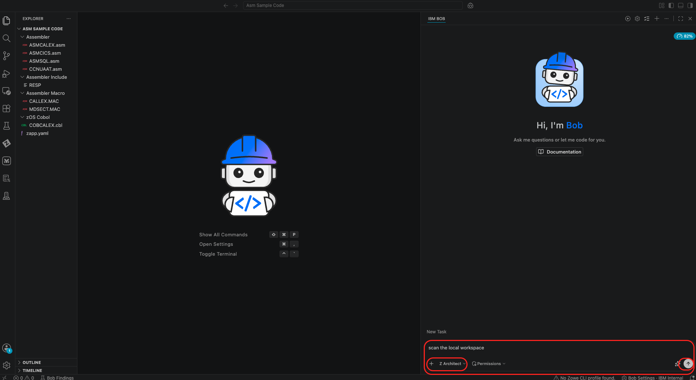

   - Bob will respond by asking you to select which type of code you want to scan. When the language selection appears, select **ASM** to tell Bob this workspace contains Assembler code.

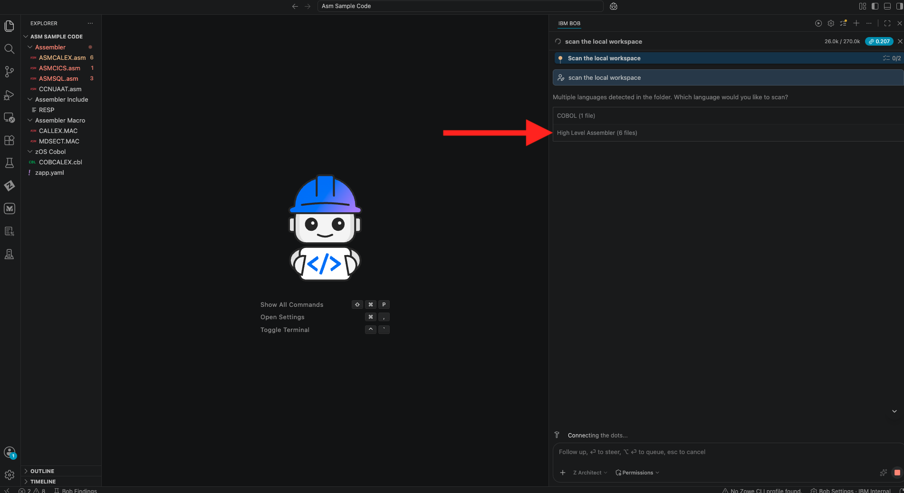

   - After selecting ASM, approve any further tool requests that appear. You can also enable **Auto Approve** in the **Permissions** dropdown to approve all requests automatically.

   > **What this does:** Bob scans every file in the workspace and builds a local metadata database — a complete map of all programs, macros, includes, call relationships, and data structures. This is what allows Bob to answer questions about the whole application rather than just the file you have open. The scan typically takes 1–2 minutes for a workspace this size.

   > **Do not close VS Code while the scan is running.** Wait for Bob to confirm it is complete before continuing.

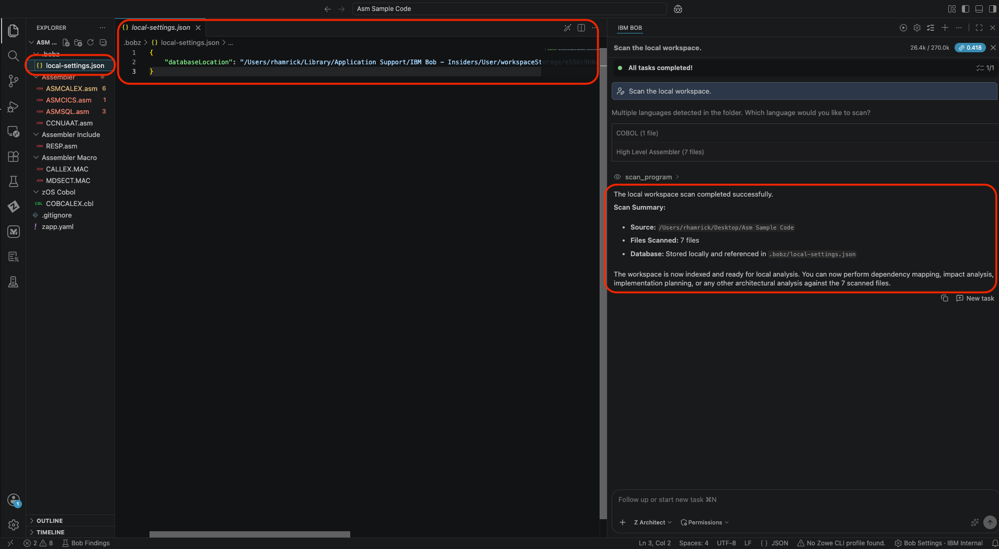

4. **Initialise AGENTS.md with /init**
   - In the chat window, enter the following prompt:

   ```
   /init
   ```

   - Click **arrow up** and approve the steps as Bob works through them.

   > **What this does:** `/init` creates an `AGENTS.md` file at the root of your workspace. This is Bob's persistent context document — it captures the workspace structure, file locations, naming conventions, and key facts about the codebase. Bob reads AGENTS.md automatically at the start of every session, so it always starts with full project context rather than starting from scratch.

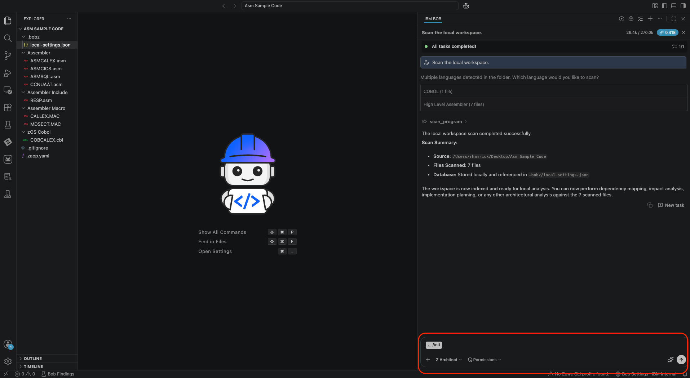

5. **Review the generated AGENTS.md**
   - You may be asked for approval of the file write — if so, approve and continue. When complete, an `AGENTS.md` file will appear in the file explorer. Click **Preview** to review it.

   > **Tip:** If AGENTS.md doesn't automatically open, locate it in the left Explorer panel, right-click it, and select **Open Preview**.

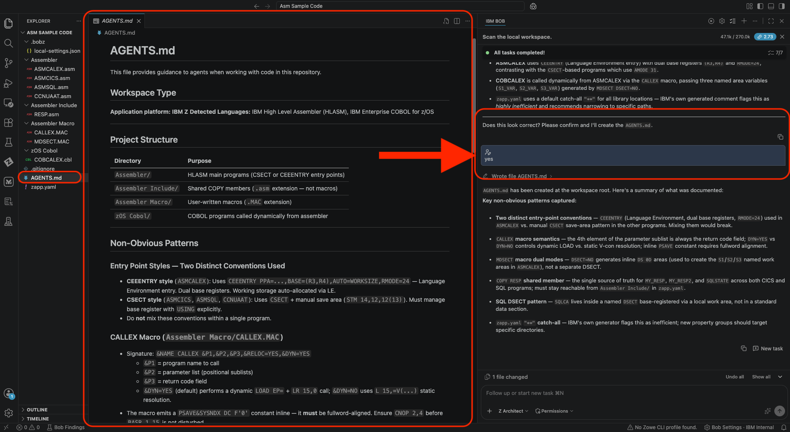

### Expected Results

- ✅ Metadata database created in the `.bobz` folder
- ✅ All 6 files in the workspace scanned and indexed
- ✅ Bob confirms the scan is complete
- ✅ `AGENTS.md` created at the workspace root
- ✅ Workspace structure, file locations, and program inventory documented
- ✅ Bob is now ready for application-level analysis

---

## Exercise: The Business Analyst View — What Does This Application Do?

With Bob fully set up, your first question is the one a business analyst or project manager would ask on day one: *what does this application actually do?* You do not need to open a single file or know anything about Assembler to ask this question. Bob will read the entire workspace and answer in plain English.

### Actions

> **Tip:** Start a new chat task by clicking the + symbol at the top or **New task** at the bottom.

> Ensure you are in **Z Architect** mode

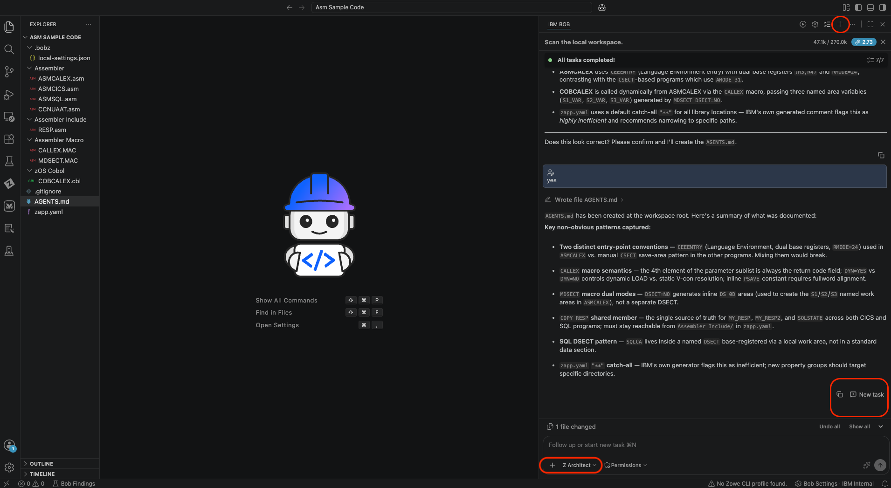

1. **Ask Bob what the application does**
   - Enter the following prompt into the chat window:

   ```
   Write a comprehensive document for a business analyst, look at the entire Asm Sample Code workspace,  all the Assembler programs, macros, and the COBOL program together, as if this is a complete application.
   Explain it in plain English, as if speaking to a business analyst who has never seen code before, use mermaid graphs when applicable:
   - What does this application do as a whole?
   - What business or technical problem does it exist to solve?
   - Who or what would call this application, and what would they get back?
   - What would stop working if this application were removed from the system?
   ```

   - Click **arrow up** to start the analysis.


   > **What you get from Bob:** A plain-English description of the whole application's purpose — told as a business story, not a technical inventory. Bob reads all six files together and synthesises a single coherent output. This is the same answer you would want before walking into a meeting with a project manager or business owner.

   > **Tip:** Take the time to review key areas of the output like Dependency Maps, Data Flow, Who calls the application, etc.

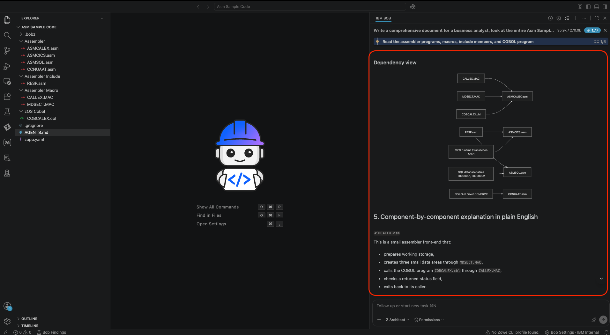

2. **Ask Bob to generate an executive summary document**
   - Enter the following prompt:

   ```
   Based on your analysis of the AsmSampleCode workspace, generate a short executive summary document for this application. Write it for a non-technical audience.
   Include: the application's purpose, the business value it delivers, the key components it contains (described in plain English, not file names), and any risks or dependencies a business stakeholder should be aware of.
   ```
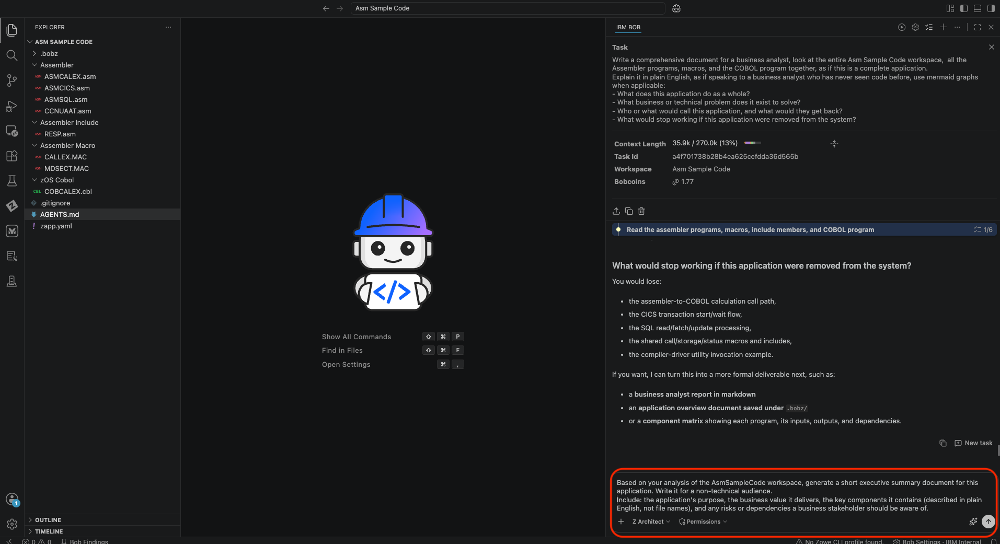

   > **What you get from Bob:** A ready-to-use document you could share with a business owner, project sponsor, or new team member who has no mainframe background. Bob generates this directly from the Assembler source — no human summarisation required.

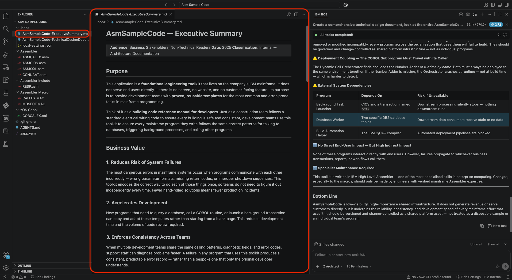

### Expected Results

- ✅ Plain-English application purpose statement produced
- ✅ Business value, components, and risks described for a non-technical audience
- ✅ Executive summary document generated — ready to share with stakeholders

---

## Exercise: The Developer View — How Does It All Connect?

Now that you have the business picture, ask Bob to show you the technical structure — how the programs relate to each other, what calls what, and where the Assembler and COBOL worlds meet.

### Actions

> **Tip:** Start a fresh chat by clicking the **+** button at the top of the chat panel before starting this exercise.

> Ensure you are in **Z Architect** mode

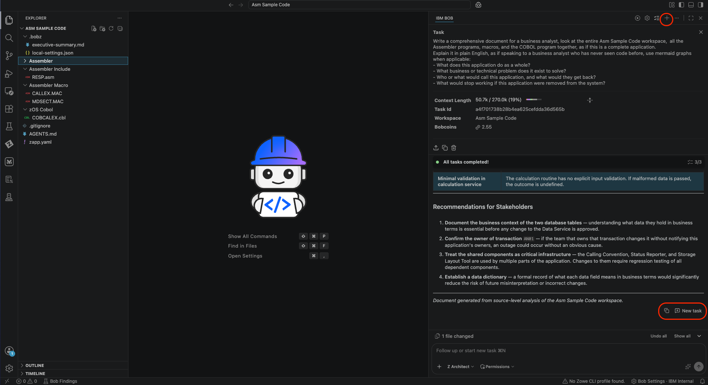

1. **Ask Bob to map the application structure**
   - Enter the following prompt:

   ```
   Looking at the whole AsmSampleCode application, show me how it is structured technically.
   - What is each program's role and how do the programs relate to each other?
   - Which programs call which — what is the full call chain from the entry point to the exit?
   - Where does the COBOL program fit in and how does it connect to the Assembler code?
   - What do the macros do and which programs use them?
   
   Generate a Mermaid architecture diagram showing every component in the application and how they connect — label each node with a one-line plain-English description of what it does.
   ```

   - Click **arrow up** to start the analysis.

   > **What you get from Bob:** A full application architecture diagram — every program, macro, and COBOL callee mapped with their connections and a plain-English label on each node. This is the kind of diagram a senior developer would spend hours producing manually from reading individual files. Bob produces it in seconds from the whole workspace.

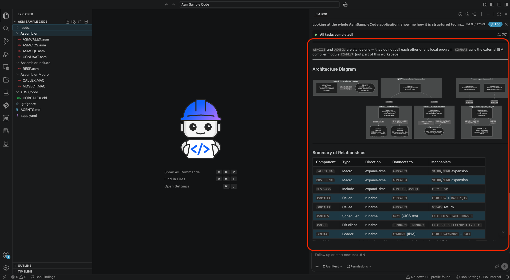

2. **Ask about the cross-language boundary**
   - Enter the following prompt:

   ```
   Focus on the point where the Assembler application calls the COBOL program.
   - What triggers the call to the COBOL program?
   - What data is passed from Assembler to COBOL at that boundary?
   - What does the COBOL program do with it and what does it return?
   - Why would an Assembler program call a COBOL program rather than doing the work itself?

   Generate a Mermaid sequence diagram showing the Assembler-to-COBOL call and return.
   ```
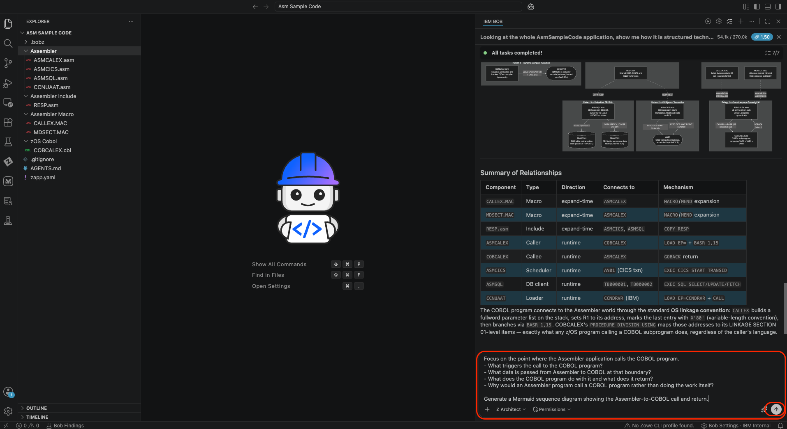

   > **What you get from Bob:** A sequence diagram showing the exact moment where two different languages hand control to each other — with the data that moves at that boundary made explicit. This cross-language interface is invisible when reading files one at a time and only becomes clear when Bob looks at the whole application together.

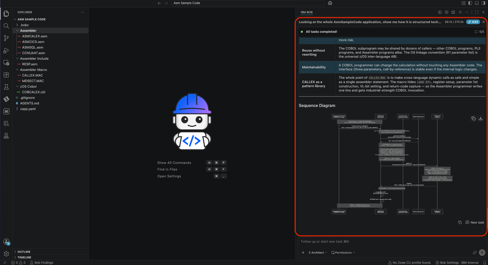

### Expected Results

- ✅ Full application architecture diagram generated showing all programs, macros, and connections
- ✅ Call chain from entry point to exit identified and mapped
- ✅ Assembler-to-COBOL boundary explained and visualised with sequence diagram

---

## Exercise: The Technical Analyst View — Data Flow and Logic Tracing

With the full application picture established, you will now narrow down to a single program — `ASMSQL.asm` — and ask Bob to trace the data flow and decision logic in detail. Because Bob already understands the whole application from the previous exercises, it can answer questions about this program in context: what role it plays, what data it received, and what it produces.

### Actions

> **Tip:** Start a fresh chat by clicking the **+** button at the top of the chat panel before starting this exercise.

> Ensure you are in **Z Architect** mode

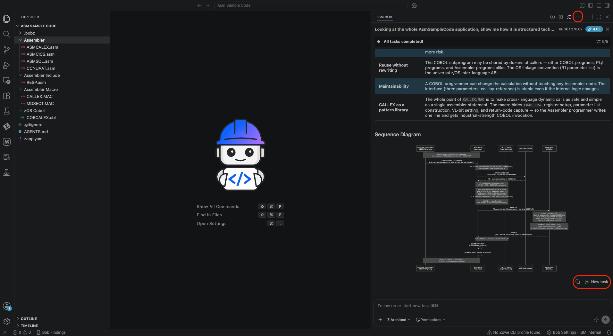

1. **Trace the data flow through the program**
   - Enter the following prompt:

   ```
   Trace how data flows through ASMSQL.asm from the moment it receives control to the moment it returns.
   - What data does it receive at entry and where does that data come from?
   - What does it read from DB2 — which tables and which fields?
   - How does the data change or get enriched as it passes through the program?
   - What does the program produce or update before it exits?

   Generate a Mermaid data flow diagram showing the data moving through the program from entry to exit.
   ```

   - Click **arrow up** to start the analysis.

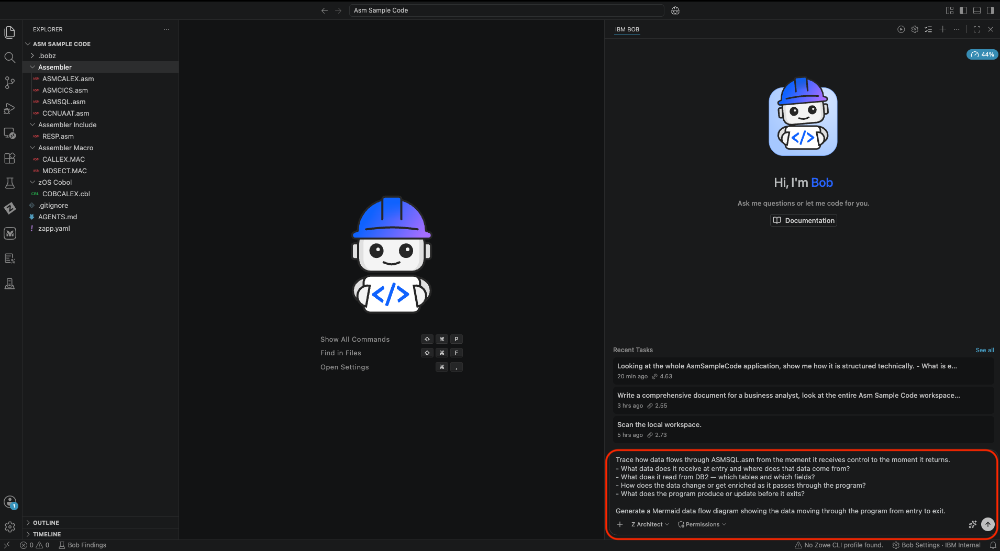

   > **What you get from Bob:** A data flow diagram showing the complete lifecycle of data inside this program — from the input it receives, through the DB2 reads, to the updates it makes before returning. This makes the program's data dependencies explicit and is directly useful for impact analysis, modernisation planning, and documentation.

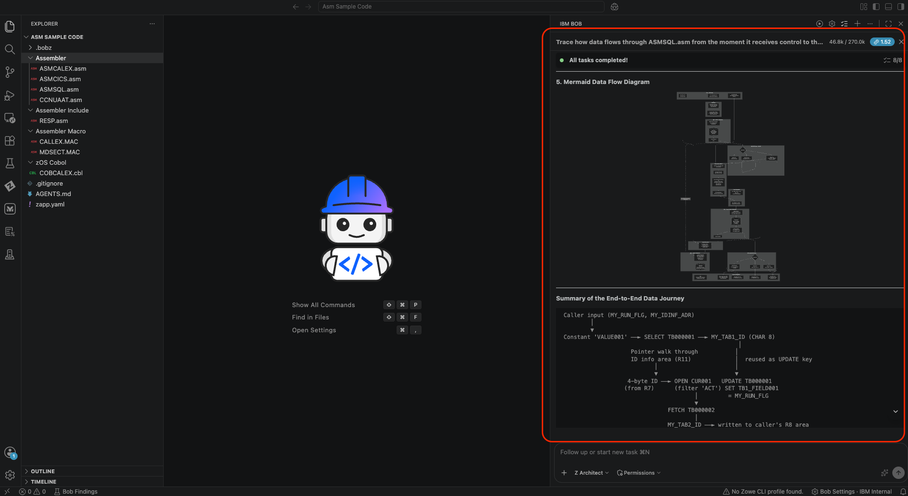

2. **Trace the decision logic**
   - Enter the following prompt:

   ```
   Looking at the decision-making logic in ASMSQL.asm — how does this program decide what to do at each step?
   Walk me through the main decision points in plain English:
   - What conditions does it check?
   - What are the possible outcomes at each decision point?
   - What does the program do differently in each case?

   Generate a Mermaid flowchart of the complete program logic from start to finish —
   use plain-English labels that describe what each decision means,
   not raw instruction names.
   ```

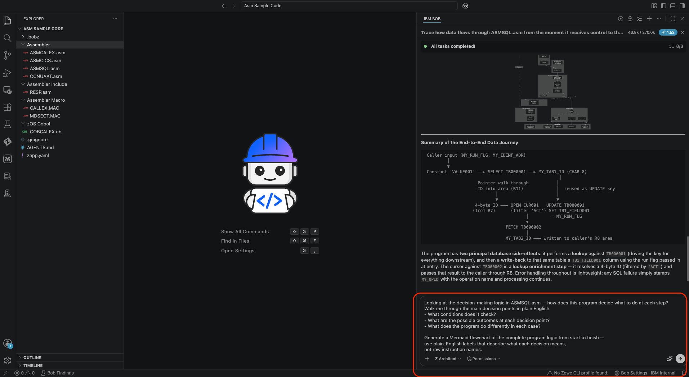

   > **What you get from Bob:** A plain-English logic flowchart of the entire program — every decision point labelled with what it means in business terms, not Assembler syntax. A COBOL developer can read this flowchart and immediately understand the program's behaviour without knowing a single Assembler instruction.

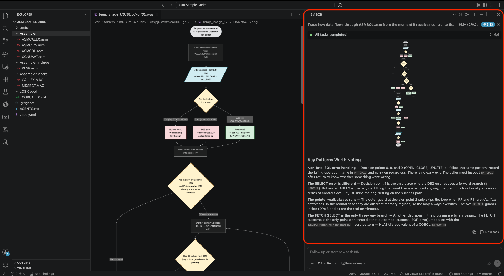

3. **Ask for the COBOL comparison**
   - Enter the following prompt:

   ```
   Take the main decision block in ASMSQL.asm — the part where it checks whether the database query succeeded and decides what to do next — and show me the equivalent COBOL logic I would write to do the same thing.

   Generate a Mermaid diagram comparing the Assembler logic path and the equivalent COBOL path side by side.
   ```
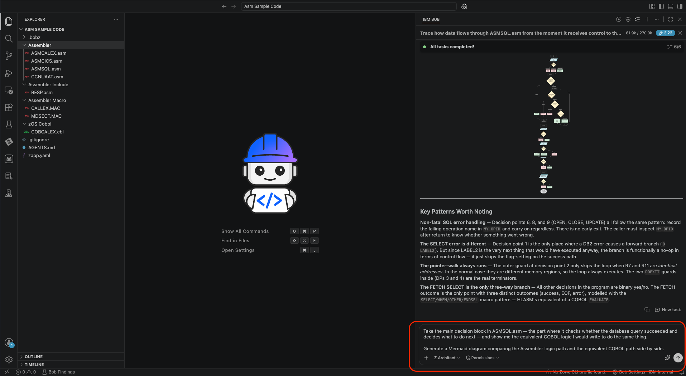

   > **What you get from Bob:** A side-by-side comparison of how the same logic is expressed in Assembler and COBOL — making it immediately clear what is familiar and what is different. This is the bridge that makes Assembler readable for a COBOL developer without requiring them to learn the language from scratch.

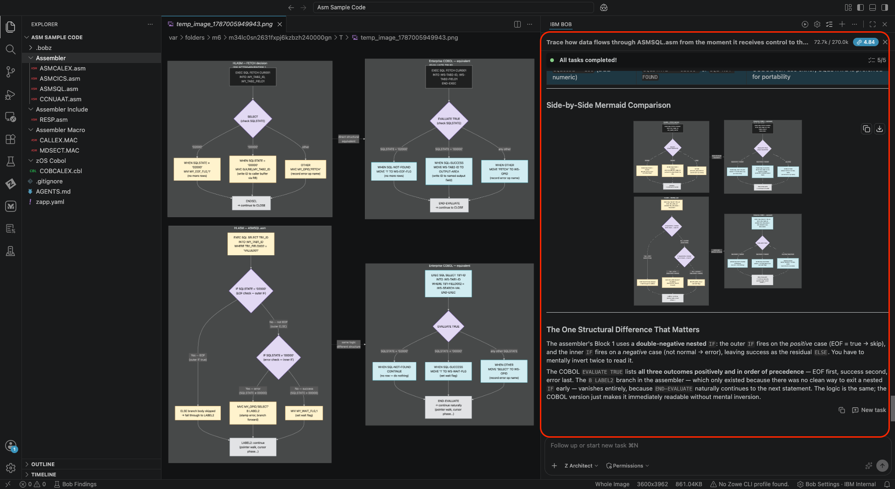

### Expected Results

- ✅ Data flow diagram generated showing all inputs, DB2 reads, and outputs for ASMSQL
- ✅ Complete plain-English logic flowchart generated for ASMSQL
- ✅ Assembler vs COBOL side-by-side comparison diagram produced
- ✅ Program behaviour understandable from diagrams alone — no Assembler knowledge required

---

## Key Takeaways

- **Set up first, ask questions second** — scanning the workspace and running `/init` gives Bob full application context before the first prompt. Every answer is better as a result
- **Bob analyses the whole application, not just one file** — asking about the entire workspace produces architecture diagrams, call chains, and data flow maps that are invisible when reading files one at a time
- **Three personas, three sets of questions** — the same application looks different depending on who is asking. Bob can answer the business analyst's question, the developer's question, and the technical analyst's question from the same codebase
- **No prior Assembler knowledge is needed** — using plain English and COBOL as a reference point, Bob explains every concept in terms you already understand
- **Narrow progressively** — start with the whole application to get context, then zoom into a single program. The application-level understanding makes the program-level questions much easier to ask and much easier to understand

---
